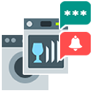

# device-reminder

Documentation of the device-reminder adapter (version 4). [Deutsche Version](../de/README.md)

## Contents

1. [Overview](#1-overview)
2. [Setup](#2-setup)
3. [Device types and detection](#3-device-types-and-detection)
4. [Adding devices](#4-adding-devices)
5. [Recipients](#5-recipients)
6. [Reminders and acknowledgement](#6-reminders-and-acknowledgement)
7. [Actions](#7-actions)
8. [Learning mode](#8-learning-mode)
9. [Migration from 3.1.2](#9-migration-from-312)
10. [Blockly](#10-blockly)
11. [sendTo API](#11-sendto-api)
12. [vis-2 widgets](#12-vis-2-widgets)
13. [States reference](#13-states-reference)
14. [FAQ](#14-faq)

## 1. Overview

The adapter watches the power consumption of a smart plug or power meter and detects when a household device (washing machine, dryer, dishwasher or any custom device) starts and finishes. It then sends a message to one or more recipients (12 messenger kinds, including voice output), optionally repeats the finished message until you acknowledge it, sets other states and can switch the plug off automatically.

Requirements: Node.js 22 or newer, js-controller 6.0.11 or newer, admin 7.8.20 or newer.

Everything is configured in the instance settings. Devices are managed in the Device Manager, which is embedded in the **Devices** tab. Each device is stored as an ioBroker device object with its own states (see [States reference](#13-states-reference)). Devices run independently of each other: an error in one device does not stop the others.

## 2. Setup

1. Install the adapter and create an instance.
2. Open the instance settings. The tabs are:
   - **Devices**: the Device Manager (see [Adding devices](#4-adding-devices)).
   - **Device types**: thresholds and detection mode per type (see [Device types and detection](#3-device-types-and-detection)).
   - **Recipients**: who receives messages (see [Recipients](#5-recipients)).
   - **General**: status texts, polling interval and the optional HTML history.
3. Create at least one recipient, then add a device in the Device Manager and select the recipient in the device form.

General settings:

| Setting | Default | Meaning |
| --- | --- | --- |
| Status texts | in action / standby / switched off | Text written to the `status` state of each device |
| Polling interval | 10 s | How often the detection evaluates the last power value |
| History as HTML | off | Additionally writes `lastOperationsHtml` (HTML table of the last operations) |


## 3. Device types and detection

Every device uses a device type. A type holds the thresholds and the detection mode. The adapter ships the types **Washing machine**, **Dryer** and **Dishwasher** plus ten editable custom types. You can fill a custom type by hand or by [learning](#8-learning-mode).

| Threshold | Meaning |
| --- | --- |
| Start value (W) | Power at or above this value counts as "running" |
| End value (W) | Power below this value counts as "run is ending" |
| Standby value (W) | Power below this value counts as "off", above it as "standby" |
| Start count / End count | Number of consecutive polls (count mode) |
| Start duration / End duration (s) | Minimum time above the start or below the end value (time and combined mode) |


### Detection modes

- **Count** (default, identical to 3.1.2): the start is detected after the configured number of polls with an average above the start value, the end after the configured number of polls below the end value. This mode needs a plug that reports regularly.
- **Time**: the device starts when the power stays at or above the start value for the start duration, and finishes when it stays below the end value for the end duration. The mode is driven by value changes plus the polling interval, so it works with plugs that only report on change.
- **Combined**: the count-based detection of 3.1.2 plus a minimum duration above the start value and below the end value. Both conditions must be met.

### Abort detection

An abort is a device that is switched off by hand while running. The option **Abort detection** is set per device and is off by default. If it fires, the status changes to "switched off" and no finished message is sent.

- In 3.1.2 the abort detection could not fire for most device types, because its standby buffer never reached the required length. This behaviour is kept when only **Abort detection** is on, so devices behave exactly like in 3.1.2. This is a peculiarity of the default types as well.
- The option **Corrected abort detection** (`abortFixed`, default off) fixes the buffer length (`max(ceil(end count / 2), 2)`) so that the abort can actually fire. Use it together with **Abort detection**.
- In time mode the abort fires when the power stays below the standby value for half of the end duration.

### Other behaviour

- A power value that is not a number (for example `null`, `true` or an empty string) is ignored and the last valid value is kept. Numeric strings such as `"12,5"` are parsed.
- If the power state does not exist (for example a deleted plug), one warning is logged per device, the device stays "switched off" and the Device Manager card shows a warning.
- Editing a running device keeps the current run as long as device type and power state stay the same. Otherwise the device is reset and an info message is logged.

## 4. Adding devices

Open the **Devices** tab and press **Add device**. There are three ways:

1. **Socket / power meter**: the Device Manager uses the ioBroker type-detector to find sockets and power meters (switch state and power state). Pick one; both states are filled in.
2. **Alias or device**: select an alias or device object; the type-detector looks for a suitable power state in it.
3. **Manual entry**: enter the power state (and optionally a switch state) yourself.

If nothing suitable is found, a hint is shown and you can use manual entry.

The device form contains:

| Field | Meaning |
| --- | --- |
| Name | Used for the object ID. IDs are unique and valid: umlauts are transliterated, spaces and dots become `_`, duplicates get `_2`, `_3` ... |
| Device type | One of the types of the **Device types** tab |
| Power state | State with the power in W (required) |
| Switch state | Optional, needed for auto-off |
| Start text / End text | Message texts |
| Abort detection | See [Abort detection](#abort-detection) |
| Auto-off | Switches the plug off the given number of minutes after the end |
| Recipients | Recipients that receive the messages of this device |
| Reminder | See [Reminders and acknowledgement](#6-reminders-and-acknowledgement) |
| Actions | See [Actions](#7-actions) |

Required fields are checked before saving.


Each device card shows status, power, runtime, a running and a finished indicator and a warning if the power state is missing. On the card you can edit, delete, enable or disable the device, switch do-not-disturb, acknowledge, send a test message and start learning. The details list the last runs, the thresholds of the type and the reminder status.

### Run behaviour

- When a run starts, the start text is sent, `running` becomes true and the status shows "in action".
- When it finishes, the end text is sent, `finished` becomes true, the runtime is stored in `lastRuntime` and the run is added to `lastOperations` (at most 14 entries).
- If the runtime exceeds `config.runtimeMax` (minutes), `alertRuntime` becomes true.
- Starting the device again counts as acknowledgement.

## 5. Recipients

A recipient is a target for messages. Create recipients on the **Recipients** tab and select them per device. Every recipient can be enabled or disabled, has an optional **time window** and a **Test** button.

### Time window

With **active from** and **active until** (`HH:MM`) a recipient only receives messages inside the window. A window may cross midnight (for example 22:00 to 06:00). Without a bound the window starts at 00:00 or ends at 23:59. Time windows apply to every recipient kind. Reminders that fall outside the window are postponed to the next window start.

**Do not disturb** (state `config.doNotDisturb` per device) only suppresses voice outputs (Alexa, SayIt). Test messages ignore time windows and do-not-disturb.

### Messenger kinds

| Kind | Settings |
| --- | --- |
| Alexa | alexa2 speech state, volume, optional volume state |
| SayIt | sayit speech state, volume, optional volume state |
| WhatsApp | adapter instance and the state the text is written to |
| Telegram | adapter instance, target type (user, chat ID or none) and target. Group chats have negative chat IDs |
| Pushover | adapter instance, title, device, priority, sound, TTL |
| Signal | adapter instance |
| Email | adapter instance, from, to (the subject is derived from the text) |
| Matrix | adapter instance |
| Discord | adapter instance, user ID, user tag, user name, server ID, channel ID |
| ntfy | adapter instance, topic (required), title, priority |
| Pushsafer | adapter instance, title, device, sound, priority |
| Gotify | adapter instance, title, priority |

The form only shows the fields that belong to the selected kind. Empty optional fields (for example TTL or Discord IDs) are omitted from the message. Telegram sends `user` or `chatId`; Pushover sends priority, retry, expire and device correctly. A recipient without a usable target is skipped with a warning instead of broadcasting.

### Voice output

For Alexa and SayIt the volume is set before speaking and restored afterwards. The volume state is derived from the speech state; if it does not exist, the text is still spoken. For Alexa groups or special setups enter the **volume state** manually (see [FAQ](#14-faq)). Pending volume resets are cancelled when the adapter stops.


## 6. Reminders and acknowledgement

Per device you can repeat the finished message until it is acknowledged.

| Setting | Default | Meaning |
| --- | --- | --- |
| Reminder | off | Enables the reminders |
| Interval | 30 min | Time between reminders |
| Maximum count | 10 | Stops after this many reminders |
| Reminder text | empty | Empty = the end text |
| Acknowledge state | empty | Optional foreign state; a change to `true` acknowledges |

A reminder only counts as sent when at least one recipient received it. Recipients outside their time window are skipped and the reminder is moved to the next window start.

A device is acknowledged by:

- writing the `acknowledge` button state of the device,
- the configured foreign acknowledge state turning `true`,
- the sendTo command `acknowledge` (and the Blockly block),
- the acknowledge button on the device card or widget,
- starting the device again.

Acknowledging stops the reminders and runs the actions of the event "acknowledged".

## 7. Actions

Actions set foreign states automatically. Add as many actions per device as you need:

| Field | Meaning |
| --- | --- |
| Event | `start`, `end`, `reminder` or `acknowledged` |
| State | The foreign state to write |
| Value | Value; converted to the type of the target state (boolean, number or string) |

An action on a missing state is skipped with a warning and never stops the other actions. Example: switch a lamp on when the washing machine has finished (`end`) and off again on `acknowledged`.

## 8. Learning mode

Learning derives thresholds from a real run.

1. Start learning from the device card (**Learn**) or write `learning.start` of the device.
2. Run a complete cycle of the machine. The recording stops automatically after 12 hours or 10,000 samples.
3. Stop learning in the Device Manager or write `learning.stop`.
4. The suggested settings are written as JSON to `learning.result` (thresholds, start duration, end duration, run duration and number of samples). The Device Manager shows them and can store them as a new custom device type.

If fewer than 20 samples were recorded or no run is recognised, `learning.result` contains an error (`tooFewSamples` or `noRun`). `learning.active` is true while recording.

## 9. Migration from 3.1.2

The first start of version 4 converts a 3.1.2 configuration automatically. The old configuration is kept as a backup in the state `info.legacyConfig`. All new options stay off, so every migrated device behaves like in 3.1.2.

What is taken over:

- devices (name, type, power and switch state, texts, abort, auto-off, recipients),
- recipients of all nine messengers of 3.1.2 (IDs are kept),
- device types, including renamed custom types,
- status texts,
- the values of the old states: last operations, last runtime, do not disturb and maximum runtime.

What is fixed during migration: Telegram user name, first name and chat ID are mapped to the fields of the telegram adapter; Pushover priority, device ID and an empty TTL are converted correctly. Devices with the same name, or with umlauts, spaces or dots in the name, get unique and valid object IDs.

Only the states created by 3.1.2 are removed. Migration warnings (unknown fields, missing device types, recipients that no longer exist, power states that do not exist) are written to the log; they do not abort the migration. If the migration itself fails, the configuration stays unchanged and the adapter keeps running.

### Old and new state IDs

3.1.2 created the states directly below `<device name>`. In version 4 they are below the device object `<deviceId>`. **Scripts, Blockly and visualisations that use the old IDs must be adapted.**

| 3.1.2 | Version 4 |
| --- | --- |
| `<name>.Status` | `<deviceId>.status` |
| `<name>.live consumption` | `<deviceId>.consumption` |
| `<name>.average consumption` | `<deviceId>.averageConsumption` |
| `<name>.runtime` | `<deviceId>.runtime` |
| `<name>.runtime in ms` | `<deviceId>.runtimeMs` |
| `<name>.lastRuntime` | `<deviceId>.lastRuntime` |
| `<name>.messageDP` | `<deviceId>.message` |
| `<name>.alert runtime` | `<deviceId>.alertRuntime` |
| `<name>.last operations` | `<deviceId>.lastOperations` |
| `<name>.config.do not disturb` | `<deviceId>.config.doNotDisturb` |
| `<name>.config.runtime max` | `<deviceId>.config.runtimeMax` |

New in version 4: `running`, `finished`, `lastFinished`, `acknowledge`, `learning.*`, `lastOperationsHtml`.

## 10. Blockly

The adapter adds Blockly blocks (11 languages):

- **Status of device**: returns the status text of the device.
- **Acknowledge device**: acknowledges the finished message.
- **Do not disturb for device**: switches do-not-disturb on or off.
- **Send test message**: sends a test message to a recipient (by recipient ID).


Script example: react when a device has finished (JavaScript adapter):

```js
on({ id: "device-reminder.0.washing-machine.finished", change: "ne" }, obj => {
	if (obj.state.val === true) {
		log("Washing machine is finished");
		setState("device-reminder.0.washing-machine.acknowledge", true);
	}
});
```

## 11. sendTo API

```js
sendTo("device-reminder.0", "status", { deviceId: "washing-machine" }, result => log(JSON.stringify(result)));
```

| Command | Message | Answer |
| --- | --- | --- |
| `list` | none | `[{ id, name }]` of all devices |
| `status` | `{ deviceId }` | `{ status, running, finished, consumption, runtime }` or `{ error: "unknownDevice" }` |
| `acknowledge` | `{ deviceId }` | `{ ok: true }` or `{ error: "unknownDevice" }` |
| `setDnd` | `{ deviceId, value }` | `{ ok: true }` or `{ error: "unknownDevice" }` |
| `testRecipient` | `{ id }` (recipient ID) | result of the test message or `{ ok: false, error: "missingRecipient" }` |

## 12. vis-2 widgets

The adapter ships two widgets for vis-2 (widget set `deviceReminder`):

- **Device card**: status, live power, runtime, estimated progress and remaining time (based on previous runs), acknowledge and do-not-disturb buttons and a collapsible run history. Select the device object with `oid`; optional compact mode and colours for running, finished and alert.
- **Device overview**: compact list of all devices of an instance with status, power, runtime and a finished indicator. A click acknowledges the device.


## 13. States reference

<!-- BEGIN STATES -->
Device states are relative to the device object `<deviceId>`. Info states are on the adapter instance.

| ID | Type | Role | rw | Unit | Name | Description |
| --- | --- | --- | --- | --- | --- | --- |
| `status` | string | text | r | - | Status | Status text (statusTexts: in action / standby / switched off) |
| `consumption` | number | value.power | r | W | Current consumption | Last power value in W |
| `averageConsumption` | number | value.power | r | W | Average consumption | Average of the polls used by the detection |
| `runtime` | string | text | r | - | Runtime | Runtime of the current run as hh:mm:ss |
| `runtimeMs` | number | value | r | ms | Runtime in ms | Runtime of the current run in ms |
| `lastRuntime` | string | text | r | - | Last runtime | Runtime of the last finished run |
| `message` | string | text | r | - | Last message | Last message text delivered for the device |
| `alertRuntime` | boolean | indicator.alarm | r | - | Runtime alert | True when the runtime exceeds config.runtimeMax |
| `lastOperations` | string | json | r | - | Last operations | JSON array of the last runs (start, end, runtime), at most 14 |
| `running` | boolean | indicator.working | r | - | Running | True while a run is in progress |
| `finished` | boolean | indicator | r | - | Finished | True after a run finished until it is acknowledged |
| `lastFinished` | number | date | r | - | Last finished | Timestamp of the last finish |
| `acknowledge` | boolean | button | w | - | Acknowledge | Write true to acknowledge; stops reminders and runs the acknowledged actions |
| `config.doNotDisturb` | boolean | switch | rw | - | Do not disturb | Suppresses voice outputs of this device |
| `config.runtimeMax` | number | level | rw | min | Maximum runtime | Maximum runtime in minutes; above it alertRuntime becomes true |
| `learning.start` | boolean | button | w | - | Start learning | Write true to start recording a run |
| `learning.stop` | boolean | button | w | - | Stop learning | Write true to stop recording and compute the suggestion |
| `learning.active` | boolean | indicator | r | - | Learning active | True while a run is recorded |
| `learning.result` | string | json | r | - | Learning result | JSON: thresholds, startDurationSec, endDurationSec, durationSec, samples, or an error (tooFewSamples, noRun) |
| `lastOperationsHtml` | string | html | r | - | Last operations (HTML) | HTML table of the last runs (only if enabled in the general settings) |
| `info.connection` | boolean | indicator.connected | r | - | Adapter connected | True when the adapter is running |
| `info.legacyConfig` | string | json | r | - | Backup of the 3.1.2 configuration (written before migration) | JSON backup of the 3.1.2 configuration, written once before the migration |
<!-- END STATES -->

## 14. FAQ

**My plug only reports when the value changes. The device is never detected.**
Use the detection mode **Time** (or **Combined**) for the device type. Count mode needs regular values.

**Alexa speaks on a group or the volume is not set.**
Enter the **volume state** of the target device manually in the recipient. The automatic derivation works for single devices only. Without a usable volume state the text is still spoken.

**Telegram does not reach my group.**
Select the target type "chat ID" and enter the chat ID of the group. Group chat IDs are negative (for example `-1001234567890`).

**The finished message was not delivered at night.**
Check the time window of the recipient. Reminders outside the window are postponed to the next window start. Voice outputs are also muted by do-not-disturb.

**The status stays "switched off" and the log shows a warning.**
The power state of the device does not exist (for example a deleted plug). Edit the device and select an existing state.

**Where is my old 3.1.2 configuration?**
In the state `info.legacyConfig` as a JSON backup.
